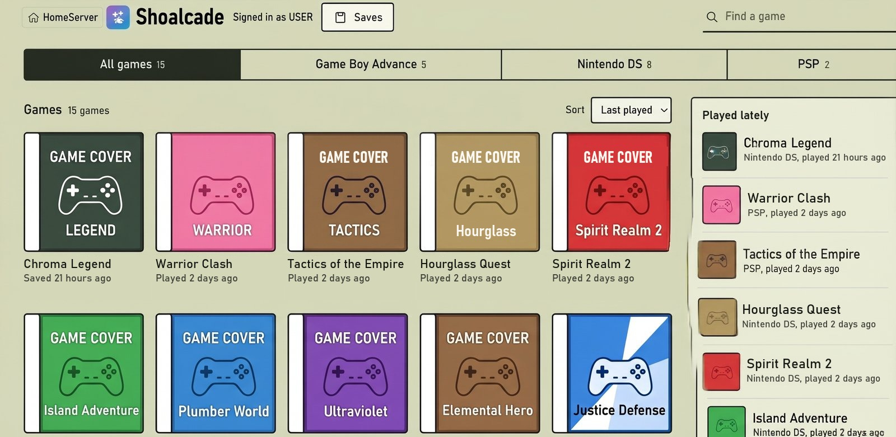
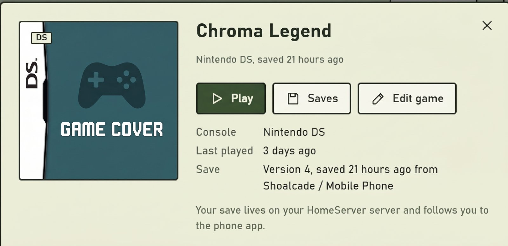
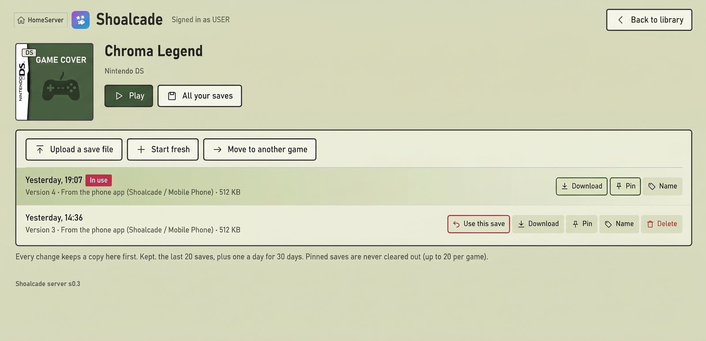

<p align="center">
  
</p>

<p align="center"><strong>Play the games you own from your own Jellyfin server: on your Android phone or Windows PC (offline) or in the browser, with safe saves.</strong></p>

<div align="center">

[](LICENSE)


-0078D4)

[][discord]

</div>

> **Not an official Jellyfin project.** Shoalcade is an independent hobby project. It is **not made, endorsed or supported by the Jellyfin team** — please don't ask them for help with it.
>
> **Jellyfin** is a trademark of Jellyfin, Inc. Shoalcade uses the Jellyfin colour gradient only, as Jellyfin's brand guidelines allow.

---

## Why Shoalcade?

**Your games already live on your Jellyfin server. Shoalcade makes them playable everywhere, and makes sure your progress is never lost.**

- 🎮 **One library, every screen:** play on your **Android phone**, your **Windows PC** (new) or in **any browser** that can reach your Jellyfin, and pick up exactly where you left off on another
- ✈️ **Truly offline on the phone and PC:** games download and run **natively**, not streamed. Plane, car, no signal: it still plays
- 💾 **Saves you can't lose:** every save is kept on your server with **full history**. **Pin** the ones that matter. If the phone and the server disagree, Shoalcade **asks you**; it never quietly picks a winner
- 📂 **Drop in, scan, play:** put your games in folders, press **Scan**, and they appear with **official names and box art**. From **Game Boy to PS1, N64, DS, PSP and 3DS**, plus **GameCube, Wii and PS2** in the Windows app (new)
- 👨‍👩‍👧 **Uses your Jellyfin as it is:** the same logins, users and libraries. Each person has their own saves, and a child only sees the libraries you give them
- 🤝 **Play together:** link phones and PCs on the same Wi-Fi for **Pokémon trades and battles** (GBA and DS), trade over the **internet through your own Jellyfin** (GBA), or use up to **four controllers** on N64
- 🧩 **The extras you'd expect:** snapshots, cheats, **fast-forward**, **screenshots**, **play time**, a built-in **patcher** for fan translations and hacks, Bluetooth controllers and button remapping
- 🔒 **Private by design:** no accounts, no adverts, no tracking, no cloud. **Everything stays on your server**
- 🆓 **Free and open source** (GPL-3.0)

> Shoalcade is for **games you own**. It never downloads games for you.

---

## Contents

- [Why Shoalcade?](#why-shoalcade)
- [What it is](#what-it-is)
- [Your own games only](#your-own-games-only)
- [Supported consoles](#supported-consoles)
  - [GameCube, Wii and PS2 (Windows app, new)](#gamecube-wii-and-ps2-windows-app-new)
- [Screenshots](#screenshots)
- [Features](#features)
- [Requirements](#requirements)
- [Install](#install)
  - [Windows app (new)](#5-install-the-windows-app-optional-new)
- [FAQ](#faq)
- [Troubleshooting](#troubleshooting)
- [Building from source](#building-from-source)
- [Community](#community)
- [Contributing, security and privacy](#contributing-security-and-privacy)
- [Licence and credits](#licence-and-credits)
- [Disclaimer](#disclaimer)

---

## What it is

**Parts that work together:**

| Part | What it does |
|---|---|
| **Shoalcade plugin** (on your Jellyfin server) | Finds the games in your library, adds names and box art, keeps everyone's saves safe with full history, and adds a **browser player** |
| **Shoalcade app** (Android) | Downloads games to your phone and plays them **natively and offline**. Saves sync back to Jellyfin |
| **Shoalcade for Windows** (new, optional) | The same for a **Windows 10/11 PC**: log in, library, download, play offline. Saves sync back to Jellyfin |

- **Jellyfin stays in charge:** your logins, your users, your library.
- **Shared saves:** the phone, the PC and the browser use the same saves, with older versions kept and **pinned** ones never cleared out.
- **Saves are never lost:** older versions are kept, and nothing is replaced without a copy.

---

## Your own games only

- Shoalcade provides **no games, ROMs, BIOS, firmware or keys**.
- It has **no piracy features**: no ROM sites, no downloads from the internet, no help finding games.
- The **patcher** only works on files you pick, and **cheats** are codes you type yourself: there's no patch or cheat download.
- Use only games **you own**, on **your own** server.
- **Issues, pull requests or chat that ask for or link to ROMs will be closed.**

---

## Supported consoles

| Console | Phone app | Windows app (new) | Browser player | Link play (phone and PC) |
|---|---|---|---|---|
| **Game Boy / Game Boy Color** | ✅ mGBA | ✅ mGBA | ✅ mGBA | ❌ |
| **Game Boy Advance** | ✅ mGBA | ✅ mGBA | ✅ mGBA | ✅ gpSP: Wi-Fi, **internet** (through your Jellyfin) and **Celio Link** (e.g. Pokémon trades and battles) |
| **Nintendo 64** | ✅ Mupen64Plus-Next (landscape) | ✅ Mupen64Plus-Next | ✅ Mupen64Plus-Next | ❌ |
| **Nintendo DS** | ✅ melonDS DS | ✅ melonDS DS | ✅ melonDS | ✅ local wireless (Wi-Fi) |
| **PlayStation (PS1)** | ✅ PCSX ReARMed | ✅ PCSX ReARMed | ✅ PCSX ReARMed | ❌ |
| **PSP** | ✅ PPSSPP (landscape) | ✅ PPSSPP | ❌ not yet | ❌ |
| **Nintendo 3DS** | ✅ Azahar (after a one-minute **3DS check**) | ✅ Azahar | ❌ (games and saves listed only) | ❌ |
| **GameCube** (new) | ➖ listed: **Plays on Windows** | ✅ Dolphin | ➖ listed: **Plays in the Windows app** | ❌ (the game's own LAN / online play: **Network adapter**) |
| **Wii** (new) | ➖ listed: **Plays on Windows** | ✅ Dolphin | ➖ listed: **Plays in the Windows app** | ❌ |
| **PlayStation 2** (new) | ➖ listed: **Plays on Windows** | ✅ LRPS2 or PCEE2 (**your own BIOS**) | ➖ listed: **Plays in the Windows app** | ❌ (the game's own LAN / online play: **Network adapter**, LRPS2 only) |

- **Same emulators, same versions** on the phone and the PC, so a save made on one plays on the other.
- **Link play works phone ↔ phone, PC ↔ PC and phone ↔ PC.**
- **GameCube, Wii and PS2 play in the Windows app only.** The phone and the browser list them, and their saves can be managed there as usual. Details: [GameCube, Wii and PS2](#gamecube-wii-and-ps2-windows-app-new).

- **PS1:** one `.chd` or `.pbp` file per game, or a game on more than one disc (see [Games on more than one disc](#games-on-more-than-one-disc)). **No BIOS needed** (a built-in stand-in is used; some games may need a real BIOS, not supported yet). Save = one **memory card**, shared by the phone and the browser.
- **N64:** `.z64`, `.n64` or `.v64` files (or a `.zip`/`.7z` holding one). Save = the cartridge save plus **Controller Pak 1**, shared by the phone and the browser.
- **3DS:** decrypted `.3ds`, `.cci`, `.cxi` or `.3dsx` files (or the compressed `.zcci`, `.zcxi`, `.z3dsx`). **No keys or system files needed**, and none are included. `.cia` installer files are listed but can't be played: convert them to `.cci` first. Before the first download, the app runs a **3DS check** (Settings → 3DS check, about a minute) to make sure your phone is fast enough; if it isn't, 3DS stays locked, with **Unlock anyway** if you want to try. On **Windows** the 3DS check is optional advice and **never locks** anything. Save = the game's save folder, zipped, shared with Jellyfin. **No cheats on 3DS.**
- **Other consoles are not shown** (SNES, Wii U and the rest). Their files stay on your server, untouched.

### GameCube, Wii and PS2 (Windows app, new)

> **New and lightly tested.** They run our own test programs (homebrew) on our test PCs. **How well real games run hasn't been tested yet.** Please report what you find on [Discord][discord].

**What you need**
- A **fast PC**: a recent processor and decent graphics. These consoles are much heavier than the others
- **GameCube and Wii check** (⚙ Settings → **3DS check** tab): plays a short test scene and tells you how well this PC keeps up. **Advice only**: the games always play
- **PS2 only:** a **PS2 BIOS file you copied from your own PlayStation 2** (see [PS2 BIOS](#ps2-bios))

**File types**

| Console | Plays | Skipped (Jellyfin's log says why) |
|---|---|---|
| **GameCube** | `.iso` `.gcm` `.rvz` `.wia` `.gcz` `.ciso` `.tgc`, homebrew `.dol` `.elf` | `.zip` / `.7z` (discs are too big to unpack) |
| **Wii** | `.iso` `.wbfs` `.rvz` `.wia` `.gcz` `.ciso`, `.wad` (WiiWare, Virtual Console), homebrew `.dol` `.elf` | `.zip` / `.7z`, split `.wbfs` (`.wbf1`…). **Wii U is not supported** |
| **PS2** | `.iso` `.chd` `.cso` `.zso` `.gz` `.ciso`, homebrew `.elf` | **`.bin` + `.cue`: make one `.chd` of the disc instead**, `.zip` / `.7z` |

- **One file per game** (or a game on more than one disc, below). Put each console in its own folder (`GameCube` or `gc`, `Wii`, `PS2`), as `.iso` files are shared by several consoles. A disc with no console in its name or folder is recognised from the disc itself.
- **No GameCube or Wii BIOS, menu or system files needed**, and none are included.

#### Games on more than one disc

- **PS1, PS2, GameCube and Wii:** put a game's discs in **their own folder**, named `… (Disc 1)`, `… (Disc 2)` and so on, **or** list them in a `.m3u` file. It shows as **one game with one save**.
- Every disc must be one of that console's own file types (no `.cue` / `.bin`), inside the game's folder.
- The **phone and the Windows app download every disc**. Change disc in the menu: **Windows → Game → Change disc** (it remembers which disc was in); **phone → side menu → Discs** (PS1).
- The **browser plays disc 1 only**, and says so.
- **Updating from an older version?** Discs that used to show as **separate games** (e.g. `Final Fantasy VII (Disc 1)`) are now **one new game**. **Their saves on Jellyfin move across by themselves** after the next library scan: the newest becomes the game's save, the others stay in its history. Nothing is lost:
  - This only happens while the combined game has **no save of its own**. Otherwise, open the old game in **Saves** → **Move to another game** (the combined game is offered first).
  - **Saves only on the phone** (never uploaded): **Settings → Saves → Not in your library** → **Upload to another game…**

#### PS2 BIOS

- PS2 games need a **BIOS file copied from your own PlayStation 2**. **Shoalcade never includes one, never downloads one and never sends it anywhere.** It is **not** stored on your Jellyfin.
- Pick it **once per PC**: **⚙ Settings → PS2 → PS2 BIOS file…**. The app checks the file and shows what it found (e.g. "Found: PS2 BIOS, Europe, v2.00"), then keeps a copy on this PC.
- Until then, a PS2 game says **"This PS2 game needs a BIOS file. Choose one in Settings → PS2 BIOS file…"** instead of starting.

#### The two PS2 emulators

- **⚙ Settings → PS2 → PS2 emulator:** **LRPS2** (the default) or **PCEE2 (newer PCSX2)**. Try the other one if a game doesn't work.
- **One memory card works in both**, so switching never moves or changes your save.
- **Snapshots only load in the emulator that made them.**
- **Right trigger as pressure ✕** (same tab, off by default): for the few games that need a light press of ✕.

#### Controls, snapshots and the rest

- **GameCube:** the pad's analogue triggers work on a controller's triggers; right stick = C-stick. Up to **four players**.
- **Wii:** **Controls → Wii controller**: **Wii Remote**, **Wii Remote, sideways**, **Wii Remote + Nunchuk** or **Classic Controller**, remembered per game. **The mouse is the pointer.** Shake: right trigger.
- **Snapshots:** packed small. Kept on your Jellyfin if they fit its snapshot limit, **otherwise kept on this PC**.
- **Rewind** (1-second steps) only where the PC is fast enough. On a slower PC it **turns itself off** for that game, and the menu says why.
- **Fast-forward** works, as fast as your PC allows.
- **Cheats:** see [Cheats](#-cheats).
- **Network adapter** (the game's page, **off** unless you switch it on for that game): for **GameCube** and **PS2** games that play over a LAN or online **in their own way**. Most games don't need it. **PS2: LRPS2 only.** Shoalcade's link play isn't used for these consoles.
- **Saves** sync like PSP saves: only the real save files go up (never an installed Wii game or an empty PS2 memory card), a few seconds after the game saves.

---

## Screenshots

**Browser library** — covers, console bar, search and a **Played lately** row



**A game's page** — **Play**, **Saves** and (for admins) **Edit game**



**Saves** — every version, with **Use this save**, **Pin**, **Name** and **Download**



**Jellyfin menu** — a **Shoalcade** link next to your other libraries


*Cover pictures in these screenshots are stand-ins.*

---

## Features

### 📱 Phone app

**Getting in**
- **Log in with Quick Connect** (approve a code from any signed-in Jellyfin device), or **Use username and password instead**
- **HTTPS only**; your login token is kept encrypted with the **Android Keystore**
- Warns clearly if the server plugin is **missing or too old**

**Your games list**
- **Box art** cached on the phone, so it shows offline
- **Sort** by **Name**, **Year**, **Platform** or **Last played** — remembered; **Last played** is the default and counts browser play too
- **Console bar:** **All**, **Nintendo ▾** and **Sony ▾**. Each menu lists that maker's consoles that have games
- **Search:** type in **Find a game** (accents and punctuation don't matter)
- **★ Favourites:** **Star** a game from its ⋮ menu, then tap **★ Favourites only** to show just those. Works with the console bar and is remembered. The same stars as the browser and Jellyfin's own favourites; kept offline
- **⬇ On phone only:** shows just the games downloaded to this phone
- **Play time** on each game ("Played 6 min"), added up from the phone, the PC and the browser
- **Background downloads** with a progress notification and **Cancel**
- **A file that isn't a game** (empty, cut short or the wrong type) is refused with a message instead of crashing the app
- **Update banner:** "Shoalcade x is ready on your Jellyfin" when your server carries a newer app
- **Remove from phone (keeps save)**
- **GameCube, Wii and PS2 games** are listed with **Plays on Windows** (they play in the Windows app)
- **Works with TalkBack:** tick boxes, messages and the Quick Connect code are read out

**Playing**
- **Loading bar** while a game starts
- **Offline play** — once downloaded, a game needs no network at all
- **Portrait or landscape** — turn the phone and the game turns with it, **without restarting**; touch buttons move to either side of the game. Or fix a console to **Portrait** or **Landscape**
- **Side menu** — swipe in from the left edge, tap **☰ Menu**, press **Back** or the controller's **Home** button. The game **pauses** while it's open, and it works fully with a controller
- **On-screen touch buttons** (multi-touch) and **Bluetooth controllers**
- **Touch buttons hide by themselves** when you use a controller; tap the screen to bring them back (**Touch buttons**: **Auto** / **Always show** / **Always hide**, set per console)
- **Controls:** change which controller button does what, **per console and per controller**, kept on the phone
- **D-pad works like a joystick too:** tap an arm, or press and slide your thumb
- **DS:** screens **stacked**, **side by side** or **one big, one small**, with **swap** — chosen separately for upright and sideways. **Touch on the bottom screen**, even while holding a button
- **PSP:** landscape, see-through controls with an **analogue stick**; each game gets its own memory stick
- **3DS:** upright, both screens stacked with the buttons below (circle pad, D-pad, A B X Y, L ZL ZR R). Sideways, **one screen at a time, full size**, with a **⇅ Flip** button to swap to the touch screen; other layouts in the menu. On a controller: left stick = circle pad, right stick = C-stick, triggers = ZL/ZR
- **N64:** landscape, with an **analogue stick** and the four **C buttons**. On a controller: left stick = N64 stick, right stick = C buttons, trigger = **Z**. **Players 2–4:** each extra controller is the next player, in the order you connect them
- **PS1:** △ ○ ✕ □ with **L1 L2 R1 R2**; controller triggers work as L2/R2. Buttons match **by position**, so a controller's **A** (bottom on Xbox pads) is **○** — swap it in **Controls** if you prefer ✕. A game on more than one disc: side menu → **Discs**
- **Game Boy cartridge clock** kept with the save and backed up (e.g. Pokémon Gold, Silver, Crystal)
- **Cheats** — side menu → **Cheats**: **Add a cheat…**, switch each one on or off, **Edit cheats…**. Shared with the browser player, and they work offline. See [Cheats](#-cheats)
- **Fast-forward** — tap **⏩** (2×, 3× or 4×, set in side menu → **Speed**). GBA goes up to 3×. Not on Game Boy / Game Boy Color
- **Screenshot** — side menu → **Game** → **Screenshot**, saved to a **Shoalcade** album in your gallery
- **Snapshots** — **Save snapshot** / **Load snapshot**, one per game with a picture, kept on the phone
- **Launch choice:** games with a snapshot ask **Continue from save** or **Or load a snapshot**, with **Delete snapshot…** to remove it (asks first; the save is kept)
- Side menu: **Close Game** or **Close Game (and Upload)**
- Warns (**Keep playing** / **Close anyway**) if your latest save couldn't be kept

**Link play** (game's ⋮ menu → **Link play**)
- **Same Wi-Fi:** two phones (or a phone and a PC running the Windows app) on the **same Wi-Fi or a phone hotspot** link directly — **no server needed**
- **GBA** and **DS**, e.g. Pokémon trades and battles. One side taps **Host**, the other **Join**
- The host shows a **4-digit PIN**; the other side types it, so no one else on the Wi-Fi can join
- Made for **Wi-Fi you trust** (home): on a shared network, pick your friend's device by its name, as someone pretending to be the host could learn the PIN
- **Over the internet (GBA):** **Host over the internet** gives a **Room code** and PIN; the other side taps **Join over the internet**. It goes **through your own Jellyfin**, so both must log in to the same server. Guide: [Internet link play](guides/internet-link-play.md)
- **Celio Link (GBA, off unless you switch it on):** **Settings → Link play → Celio Link (trade with PC players)**, then **Trade with a PC player (Celio Link)** → **Make a room** or **Join a room**. For trading with people on a PC using Celio Link. ⚠️ It uses an **outside server** not run by Shoalcade or your Jellyfin (see [Privacy](guides/privacy.md))
- Optional per-phone **DS wireless ID** switch
- Snapshots, cheats and fast-forward are off during link play

**Settings** (⚙ on the games list)
- Set **each console** without starting a game: **Screen**, **DS screens**, **Touch buttons** and **Controls**
- The side menu changes the **same settings** while you play, so the two always agree
- **Push all** / **Pull all**, your server and account, **Log out** (also ends the app's sign-in on Jellyfin; phone saves stay), storage used, and **About**
- **Saves → Not in your library:** phone saves for games that left your library — **Save a copy to a file…** or **Upload to another game…** (nothing is deleted)

**Save sync** (safety rules under [Saves](#-saves))
- **Upload save to Jellyfin** and **Get save from Jellyfin** per game
- **Push all** / **Pull all** (in **Settings**) — every downloaded game brought up to date in one go; any game needing a decision is listed at the end. A running one shows on the games list with **Stop**
- **Upload saves automatically** (**Settings → Saves**, on by default) — saves made offline go up to Jellyfin **by themselves** once the phone is back online. If Jellyfin's save changed meanwhile, nothing is sent: a notification asks you to choose
- **Saves on Jellyfin…** panel: version list, **Use this save**, **Pin**, **Name**, **Replace with a file…**, **Save a copy to a file…**
- Tells you **once** if a phone save belongs to a game that's **no longer in your library**
- Moves old phone saves across from JellyEMU safely (asks if they differ)
- **About and licences** screen listing every included part and its source

### 💻 Windows app (new)

> **First release.** It passes our automated tests (including on Windows code run under Wine), but it has **not yet been widely tested on real Windows PCs**. Please report problems on [Discord][discord].

**Getting in and your library**
- **Looks like the plugin's browser pages** (new): the same colours, console strip, game tiles and game sheet
- **Log in** with your username and password, or **Use Quick Connect instead**. **HTTPS only**
- Your login token is protected by **Windows** for your Windows account only, and never logged
- Box art grid, **Find a game**, console bar, **Sort**, **★ Favourites only**, **⬇ On this PC only** and **play time**, as on the phone
- **Download** with progress and **Cancel**. Downloaded games play **offline**
- **⚙ Settings** opens as a **panel down the right-hand side**, with tabs: **Account**, **Saves**, **Display**, **PS2**, **Link play**, **3DS check**, **About**
- **Update banner:** "Shoalcade x for Windows is ready." with **Get it**, when your Jellyfin says there's a newer Windows app

**Playing**
- Each game opens **in its own window**. **Keyboard** and **game controllers**
- **Pause menu** with the phone's sections: **Game**, **Snapshots**, **Speed**, **Cheats**, **Sound**, **Display**, **Controls**
- **GameCube, Wii and PS2** (new): see [GameCube, Wii and PS2](#gamecube-wii-and-ps2-windows-app-new)
- **Fast-forward** 2×, 3× or 4× on **every console**, and **Rewind** on GB, GBC, GBA and PS1 (and GameCube, Wii and PS2 where the PC is fast enough)
- **Screenshot** — saved as a picture in your **Pictures** folder
- **Display:** in a window or full screen, **Whole-number scale**, **Smooth picture**
- **Picture size** (⚙ Settings → **Display**): **1×–4×** per console for N64, PSP, 3DS, GameCube, Wii and PS2. Bigger is sharper in a big window but needs a faster PC
- **Change disc** (menu → **Game**) for a game on more than one disc
- **DS:** the phone's screen layouts with swap, **remembered between games**; the **mouse is the touch screen**
- **3DS:** four screen layouts plus **Flip**; the mouse is the touch screen. **3DS check** (⚙ → **3DS check**) only gives advice, it never locks
- **Controls:** change any **key**, **controller button** or **shortcut key** in the menu: pick the button, then press the new one. Saved on the PC **per console** (and per **controller model**, as on the phone), with **Reset** back to the defaults
- **Restart** the game from the menu (press it twice). The save is written first
- **No keyboard?** Move the mouse and a **☰** button shows in the top-left corner: click it for the menu

**Saves** (the phone's own rules, the same code)
- **A backup before every game.** If the PC and Jellyfin both changed, it **asks**
- Saves go up **a few seconds after you save in the game**, or **once you're back online** (**Upload saves automatically**)
- **Close Game** / **Close Game (and Upload)**, **Push all** / **Pull all** (⚙ → **Saves**)
- The full saves list with the browser's tools: **Use this save**, **Pin**, **Name**, **Move to another game**, **Start fresh**, **Download all my saves**
- **Snapshots:** **Slot 1–3** plus **Automatic**, kept on your Jellyfin so they follow you between PCs (PSP and 3DS snapshots stay on the PC; GameCube, Wii and PS2 ones too, if they're bigger than your Jellyfin's snapshot limit)
- **Cheats** (not 3DS): game card → **Cheats…**, or the **Cheats** button beside the stage while a game is open: **add**, **edit**, **delete** and switch codes on and off, the same list as the phone and browser. The pause menu switches them too
- ⚠️ **Needs plugin 0.10.0.0 or newer** to upload saves. With an older plugin, the save **stays on the PC** and waits to go up

**Link play**
- **GBA** and **DS** on the **same Wi-Fi**, with the PIN: **PC ↔ PC** and **PC ↔ phone**
- **GBA over the internet** through your own Jellyfin, and **Celio Link** (⚙ → **Link play**, off by default)
- The first time a PC hosts, **Windows Firewall** asks: **allow it on private networks**, or others can't find the host

**Installer**
- **No admin needed.** Desktop and Start menu shortcuts
- **Updates install over the top**
- **Uninstalling never deletes your saves**: games, saves and login stay in `%LOCALAPPDATA%\Shoalcade\`
- **About Shoalcade** lists every part, its licence and its source

### 💾 Saves

- **One save list per game, per person** — shared by the phone, the Windows app and the browser (DS included)
- **Version history:** the last **20**, plus **one a day for 30 days** (admins can change both)
- **Pin** a version (never cleared out), **Name** it, and see the **In use** badge
- **Use this save** — makes an older version current. **The save you were using stays in the list**
- Each version shows **where it came from**: the browser player, the phone app, **the Windows app**, an uploaded file, JellyEMU (imported) and more
- **Conflicts always ask, never pick silently.** If the phone (or PC) and Jellyfin both changed: **Keep the phone's**, **Keep Jellyfin's** or **Decide later**. Both are kept either way
- **Newer-save check:** before a save would replace a newer one, you're asked, with both dates shown
- **Backups before every overwrite:** the replaced save goes to Jellyfin's history and the phone's backups first. If that fails, nothing is replaced
- **Snapshots are kept separate:** loading a snapshot **never changes your save** — only saving in the game does. A save made after loading one is marked **Saved after loading a snapshot**
- **Saves made with cheats on** are marked **Made with cheats on**, and your last save from before cheats is **pinned as "Before cheats"** so it's never cleared out
- **DS and PS1 save sizes checked** — wrong-sized files are refused, so a save can't be quietly damaged. GameCube, Wii and PS2 saves are checked too
- **Empty PS1 memory cards** are never saved over a real save (unless you say so)
- **Damaged files are moved aside, never deleted**
- **Storage limits** per person: saves **2 GB** and snapshots **4 GB** by default, admin-adjustable

### 🌐 Browser player

**Library**
- Open it from the **Shoalcade** link in Jellyfin's menu, or at **`/shoalcade/`** on your server
- Uses your **Jellyfin web login** — no extra sign-in
- **Game covers**, **search** and a **Played lately** row; works on phones too
- **Play time** on each game's sheet ("Played 2 min"), added up with the phone and the PC
- **★ Starred** chip: star a game from its sheet, and the star shows on the phone too
- **Console bar:** **All**, **Nintendo ▾** and **Sony ▾** — the menus list each console that has games
- **Sort** by **Name**, **Year**, **Platform** or **Last played** — remembered per person, on any browser
- **Play** and **Saves** buttons on each game's own Jellyfin page
- **Snapshots** button on a game's sheet (when it has some): opens them on the game's Saves page, to download or delete
- **GameCube, Wii and PS2 games** are listed with **Plays in the Windows app** (no Play button); their saves work in the Saves manager as usual
- **⚙ Settings:** **Manage saves**, **Download all my saves** (one zip, the save in use for each game), **Phone app** (QR code or download link for the app), **Windows app** (a link to this release's download page), per-console **Browser player** settings with **Reset to defaults**, and **Patch a game**

**Playing** (powered by **EmulatorJS**)
- **Loading bar** while a game starts
- **Keyboard, gamepad and touch** controls
- Change your own controls **per console and per controller**, stored on the server
- Toolbar that hides itself: **pause**, **restart**, **fast-forward**, **volume**, **full screen**, **screenshot**
- **Quick snapshot** (F2) and **Load snapshot** (F4); snapshot slots kept on the server; **Snapshots** switch in settings
- **Old Game Boy snapshots** (made before the browser player changed its Game Boy emulator) show in their slot with a note that they **can't be loaded**, and are kept until you delete them
- **A game on more than one disc** plays **disc 1 only** here, with a note; change discs in the Windows or phone app
- **Cheats** tab in the player's settings: add, switch on and off, edit and delete codes (see [Cheats](#-cheats))
- **DS:** three **screen layouts** (plus swap), changeable while playing; **touch screen works with mouse and finger**
- **Sideways phone:** touch buttons sit in columns **beside the game**, not over it
- **N64:** keyboard **arrows** = stick, **I J K L** = C buttons, **A** = Z, **Y G H B** = D-pad. On a pad: left stick = N64 stick, right stick = C buttons, triggers = Z. Up to **4 pads** = players 1–4
- **PS1:** keyboard **E / R** or pad **LT / RT** for L2 / R2; very big discs show a note that they need a lot of memory
- **Saves upload by themselves** a few seconds after the game saves
- **Leaving too soon?** It asks: **Your save hasn't reached the server yet** → **Stay** or **Leave anyway**
- If another device changed the save: **Keep this browser's save** or **Keep Jellyfin's save (restarts the game)**

**Saves manager**
- Every version of a game's save: **Use this save**, **Pin**, **Name**, **Download**, **Upload a save file**, **Delete**, **Start fresh**
- **Move to another game** — e.g. after a ROM was renamed (Game Boy ↔ Game Boy Color allowed; otherwise same console only). If Shoalcade never recorded a removed game's console, you **pick the console first**, then the game (browser and Windows app)
- Saves for games **Not in your library** stay reachable and movable, or **Delete all saves for this game** (only for a game no longer in your library; asks twice and you type its name). The server keeps a hidden copy for **7 days** so the admin can undo a mistake
- Asks first before anything that could lose data

### 🎯 Cheats

- **Your own codes**, per game: GameShark, Game Genie, CodeBreaker, Action Replay or CWCheat, depending on the console
- **Several at once**, each switched on or off by itself — in the **browser player**, the **phone app** and the **Windows app**, kept in step through Jellyfin
- **Snapshots remember which cheats were on.** Loading one turns those back on
- **Saves stay safe:** saves made with cheats on are marked, and your save from before cheats is kept (see [Saves](#-saves))
- Switching a cheat off **doesn't undo** what it already changed in the game
- **No cheat database** — you add the codes yourself
- Notes: **DS in the browser** — a cheat you switch off stays on until you leave the game and start it again. **Link play** has no cheats

| Console | Codes that work |
|---|---|
| **GB / GBC** | GameShark, Game Genie |
| **GBA** | CodeBreaker, GameShark, Action Replay |
| **N64** | GameShark (`8XXXXXXX YYYY`) |
| **DS** | Action Replay (cheat sites often call these "GameShark DS": same codes). **CodeBreaker DS codes don't work**: Shoalcade says so when you add one (use the Action Replay version) |
| **PS1** | GameShark |
| **PSP** (app) | CWCheat |
| **GameCube** (Windows app) | **Gecko** (`04xxxxxx yyyyyyyy`). Action Replay: encrypted codes (`XXXX-XXXX-XXXXX`) as written; put **`AR:`** in front of unencrypted ones |
| **Wii** (Windows app) | **Gecko** (also called Ocarina) |
| **PS2** (Windows app) | Unencrypted codes (`2xxxxxxx yyyyyyyy`) or **pnach** lines (`patch=1,EE,…`). **Encrypted CodeBreaker, GameShark and Action Replay MAX codes don't work** |

- **GameCube, Wii and PS2:** add and edit these codes in the **Windows app** (game card → **Cheats…**), as the phone and browser don't open these games. A pasted pnach line is kept as its two blocks of 8 (`patch=1,EE,2xxxxxxx,extended,yyyyyyyy` → `2xxxxxxx yyyyyyyy`), which works the same.

### 🩹 Patch a game

- **⚙ Settings → Patch a game** in the browser: pick **your game file** and a **patch** (a hack, translation or fix), and the patched game downloads
- Works with **IPS, UPS, BPS, PPF, xdelta, APS, RUP and PMSR** — including xdelta3's normal compressed patches
- **Everything happens in your browser:** nothing is uploaded and your library isn't changed
- **Wrong game file?** BPS, UPS and xdelta patches check it, so you get a warning instead of a broken game (with **Patch anyway** if you're sure)
- To play the result, put it in your Jellyfin games folder

### 🗂️ Server and library

- **Own game scanner** — finds GB, GBC, GBA, N64, DS, PS1, PSP, 3DS, GameCube, Wii and PS2 games, including zipped games and [games on more than one disc](#games-on-more-than-one-disc)
- A file is only listed if its type fits its folder's console (e.g. a `.gba` in a `PSP` folder is skipped)
- **Never silent:** Jellyfin's log names every file and folder the scanner leaves out, and why
- **Official names, year, developer, publisher and genre** from **libretro-database** (downloaded by your server, checked weekly, works from its own copy)
- **Box art** from libretro — your own pictures next to the ROMs and `.nfo` files still come first
- Box art switches itself on for games libraries (**Shoalcade box art (libretro)**; untick it any time)
- **Games library set-up in one click** from the settings page — never writes into your ROM folder
- **Games kept off Jellyfin's home page** and library menu by default. Search still finds them, and each person can put them back
- **Install from Jellyfin's own Catalogue** (plugin repository) or by hand
- Version shown on the settings page, browser pages and the app's About screen

### 🛠️ Admin tools

- **Admin game editor** (Jellyfin admins only, in the browser library): **Edit game** → **Save name**, **Upload a picture**, **Find a cover**, **Reset to automatic**
- **Locked edits:** your names and covers **survive library scans and "Replace all metadata"**
- **Find a cover** searches libretro's list for that console and shows a preview before you pick
- **Storage view:** each person's saves, snapshots and settings against their limits, server totals and a per-game breakdown — **sizes only, never anyone's save contents**
- **Settings:** browser player on/off, menu link and Play/Saves buttons on/off, keep games off the home page, versions and days kept, storage limits
- **Allow link play over the internet** (on by default): untick it to stop GBA link play through your server. Wi-Fi link play works either way
- **Show the Windows app link**: the Windows app section in Shoalcade's Settings, linking to this release's page on GitHub
- **Import JellyEMU saves** scheduled task — copies saves **read-only**; JellyEMU's files are never changed
- Shoalcade's scanner **stays off while JellyEMU is installed**, so the two never fight. Guide: [Moving from JellyEMU](guides/moving-from-jellyemu.md)

### 🔒 Security

- **Every endpoint needs a Jellyfin login**; admin features need a Jellyfin admin
- **Only ROM items are ever served** — your films and other media are never exposed. The one extra file is the phone app built into the plugin
- **Phone app download links** for QR codes last **10 minutes** and hold no login
- People see **only their own saves and settings**
- Game downloads use **Jellyfin's own download route** (login, library access and download permission all checked)
- **ROM file guard:** a disc list can't point outside its games folder
- **Upload limits:** a few at once per person, size caps, snapshots streamed to disk
- **Picture uploads** checked by their actual bytes and size
- Browser pages: strict security policy (they can only talk to your server), no HTML built from game names
- **Browser player sandbox:** the emulator runs walled off from your Jellyfin sign-in, so even a faulty emulator file could only reach the game you're playing
- **App:** HTTPS only, token encrypted with the **Android Keystore**, never logged, never in a web address
- **Windows app:** HTTPS only, token protected by Windows for your account (DPAPI), never logged. The game player never sees the token
- **Internet link play:** only your Jellyfin users who can see a GBA game can open or join a room, the PIN never leaves the devices, and link data is never stored or logged. Admins can switch it off

### 🕶️ Privacy

- **No analytics, no tracking, no ads, no accounts with us**
- The only outside contact is **your server → libretro**, for game names and box art. No ROMs, hashes, saves or user names are sent
- The phone and Windows apps talk **only to your Jellyfin server** (and to the other player during link play)
- **One opt-in exception: Celio Link.** It's **off** until you switch it on. When used, link data and your IP address go to the **Celio Link server**, which is not run by Shoalcade or your Jellyfin
- The **patcher** never sends your files anywhere: it runs in your browser
- **Network adapter** (Windows app, GameCube and PS2, **off** unless you switch it on for a game): the game itself can then use the network in its own way (LAN or online), as on the real console. Wii games have the Wii's own network built in
- **Your PS2 BIOS** stays on your PC: never uploaded, never sent anywhere
- Full detail: [Privacy](guides/privacy.md)

---

## Requirements

| For | You need |
|---|---|
| **Server** | **Jellyfin 12.3 or newer** (tested on 12.3 and 12.4), an admin account, and an **HTTPS** address (the app won't use plain HTTP) |
| **Phone app** | **Android 11+** on a **64-bit ARM** phone (almost every phone from the last few years) |
| **Windows app** (new) | **Windows 10 or 11, 64-bit** (x64), about **350 MB** of disk space plus your games (the installer is about 195 MB). Saves from Windows need plugin **0.10.0.0 or newer** |
| **GameCube, Wii, PS2** (Windows app) | A **fast PC** (recent processor, decent graphics; real-game speed not tested yet). **PS2:** a BIOS file from **your own** PlayStation 2 |
| **Browser player** | A modern browser (Chrome, Edge, Firefox, Safari) on a computer, tablet or phone |
| **Games** | Your own games, in a folder Jellyfin can read |
| **Internet link play** | Both players logged in to the **same Jellyfin**, each user allowed **remote connections** |

---

## Install

**Four steps:** install the plugin on Jellyfin → make a games library → install the app → log in. **Step 5** (the Windows app) is optional.
**Moving from JellyEMU?** Read [Moving from JellyEMU](guides/moving-from-jellyemu.md) **first**. Full detail and pictures: [Install guide](guides/install.md).

### 1. Install the plugin on your Jellyfin server

<details open>
<summary><strong>Option A — From Jellyfin's Catalogue (easiest; updates show up in Jellyfin)</strong></summary>

1. In Jellyfin: **Dashboard → Plugins → Repositories → +**
2. Name: **Shoalcade**. URL: **`https://raw.githubusercontent.com/BBBannon/Shoalcade/main/manifest.json`**
3. **Dashboard → Plugins → Catalogue → Shoalcade → Install**
4. **Restart Jellyfin**, then refresh the browser (**Ctrl+F5**)

</details>

<details>
<summary><strong>Option B — Manual install (zip file)</strong></summary>

1. Download **`Shoalcade_s<version>.zip`** from [Releases](https://github.com/BBBannon/Shoalcade/releases)
2. Unzip it into Jellyfin's **`plugins/Shoalcade_<version>/`** folder:
   - **Linux (usual):** `/var/lib/jellyfin/plugins/`
   - **Docker:** the `plugins` folder inside your `/config` volume
   - **Windows:** `C:\ProgramData\Jellyfin\Server\plugins\`
3. Linux only: make sure Jellyfin can read it — `chown -R jellyfin:jellyfin <folder>`
4. **Restart Jellyfin**

</details>

**Check:** **Dashboard → Plugins** shows **Shoalcade** as **Active**.

### 2. Make a games library

1. Put your games in **one folder per console** (short names work too: `gb`, `gbc`, `gba`, `n64`, `nds`, `ps1`, `psx`, `psp`, `3ds`, `gc`, `wii`, `ps2`):

```
/media/games/
├── Game Boy/            .gb
├── Game Boy Color/      .gbc
├── Game Boy Advance/    .gba
├── Nintendo 64/         .z64 .n64 .v64
├── Nintendo DS/         .nds
├── Nintendo 3DS/        .3ds .cci .cxi .3dsx (+ compressed .zcci .zcxi .z3dsx)
├── PS1/                 .chd .pbp   (one file per game)
├── PSP/                 .iso .cso .pbp .chd
├── GameCube/            .iso .gcm .rvz .wia .gcz .ciso   (Windows app)
├── Wii/                 .iso .wbfs .rvz .wia .gcz .ciso .wad   (Windows app)
└── PS2/                 .iso .chd .cso .zso .gz   (Windows app; not .bin/.cue)
```

2. **Dashboard → Plugins → Shoalcade → Add a games library**
3. Give it a **Name** and the **ROM folder on the server** → **Create games library**
4. Press **Scan for new games** and wait for it to finish

- A `.zip` or `.7z` holding one game is fine (not PS1, GameCube, Wii or PS2). **Nothing is ever written into your ROM folder.**
- **PS1:** not yet `.bin/.cue`, `.iso` or archives — see the [Install guide](guides/install.md).
- **Games on more than one disc:** a folder of `(Disc 1)`, `(Disc 2)` files or a `.m3u` — see [Games on more than one disc](#games-on-more-than-one-disc).

### 3. Install the app on your Android phone

1. Get the app, either way:
   - **From your Jellyfin:** open Shoalcade in a browser, then **Settings → Phone app**. Scan the QR code with the phone, or tap **Download the phone app**. The app comes inside the plugin, so its version always matches.
   - **From GitHub:** [`Shoalcade.apk`](https://github.com/BBBannon/Shoalcade/releases/latest/download/Shoalcade.apk) (always the newest). Each [release](https://github.com/BBBannon/Shoalcade/releases) has `Shoalcade.apk` and `Shoalcade-<version>.apk`.
2. Open it. When asked, allow **Install unknown apps** for your browser or file manager
3. Tap **Install**

- **Updating:** install the new APK over the old one. Your login, games and saves stay.
- **Don't uninstall first** — that deletes the phone's saves. **Push all** before any uninstall.

### 4. Log in

1. Open **Shoalcade** and type your server's **HTTPS** address
2. **Log in with Quick Connect** (approve the code on any signed-in Jellyfin device — an admin turns Quick Connect on in **Dashboard → General**), or **Use username and password instead**
3. Tap a game → **Download** → **Play**

**Browser player:** open the **Shoalcade** link in Jellyfin's menu, or go to `https://<your-server>/shoalcade/`.

### 5. Install the Windows app (optional, new)

> **First Windows release:** not yet widely tested on real PCs. Your saves are kept safe by the same rules as the phone.

1. **Update the plugin to 0.10.0.0 or newer first** (step 1). Older plugins don't accept saves from Windows
2. Download **`ShoalcadeApp-win-Setup.exe`** from the [latest release](https://github.com/BBBannon/Shoalcade/releases/latest)
3. Run it. The installer is **not signed yet**, so Windows SmartScreen says **"Windows protected your PC"**:
   - Click **More info** → **Run anyway**
4. It installs **for your Windows account only** (no admin needed), with Desktop and Start menu shortcuts
5. Open **Shoalcade**, type your server's **HTTPS** address, and **Log in** (or **Use Quick Connect instead**)
6. Click **Download** on a game → **Play**
7. **PS2 only:** pick your BIOS once on this PC: **⚙ Settings → PS2 → PS2 BIOS file…** (a file copied from **your own** PlayStation 2; see [PS2 BIOS](#ps2-bios))

- **Updating:** run the new `ShoalcadeApp-win-Setup.exe` over the old one. Your login, games and saves stay.
- **Uninstalling** (Windows **Settings → Apps**) keeps your games, saves and login in `%LOCALAPPDATA%\Shoalcade\`. Saves not yet uploaded are only there.
- **Link play:** the first time the PC hosts, allow Shoalcade on **private networks** when Windows Firewall asks.

---

## FAQ

**Is this legal? Where do I get games?**
Shoalcade is an emulator front-end with **no games inside** and **no help finding them**. Use only games you own — the law on making your own copies differs by country, so check yours.

**Why isn't it on Google Play?**
It's a hobby project that plays your own files from your own server. You install the APK from [GitHub Releases](https://github.com/BBBannon/Shoalcade/releases). Updates install over the top and keep your games and saves.

**Does it work offline?**
**Yes.** Once a game is on your phone or PC, it plays with no network at all. Saves go up by themselves when you're back online (**Upload saves automatically**, on by default). The browser player needs your server.

**Is there a Windows version?**
**Yes, new in v0.10.0.** It does what the phone app does: log in, library, download, play offline, saves synced with the phone and the browser, and link play with phones. It also plays **GameCube, Wii and PS2** (new). It's still **new**, so expect rough edges and please report them. See [Windows app](#-windows-app-new) and [Install step 5](#5-install-the-windows-app-optional-new).

**Windows says "Windows protected your PC". Is that safe?**
The installer isn't **code-signed** yet, so SmartScreen warns about it. Click **More info → Run anyway**. Only do this for `ShoalcadeApp-win-Setup.exe` downloaded from this project's [Releases](https://github.com/BBBannon/Shoalcade/releases).

**Can I trade over the internet?**
**Yes, GBA only.** **Link play → Host over the internet** gives a room code and PIN. It runs **through your own Jellyfin**, so both players log in to the same server. See [Internet link play](guides/internet-link-play.md). To trade with someone using **Celio Link** on a PC, switch on **Celio Link** in Settings (it uses an outside server).

**Where are my saves, and are they safe?**
On your Jellyfin server, one list per game per person, with **version history** (last 20, plus one a day for 30 days). Nothing is replaced without a copy first. Back up Jellyfin's data folder (`shoalcade/` inside it) like the rest of Jellyfin.

**What if the phone and the server saves are different?**
The app **asks**: **Keep the phone's**, **Keep Jellyfin's** or **Decide later**. It never picks silently, and both copies are kept either way.

**Do snapshots sync?**
No. Only **in-game saves** sync. Snapshots stay where you made them (phone, browser or Windows app), and loading one never changes your save. Windows snapshots are kept on your Jellyfin, so they follow you between PCs (except PSP and 3DS, and GameCube, Wii or PS2 ones too big for your Jellyfin's snapshot limit).

**Can I use cheats?**
Yes — your own codes, in the browser player's **Cheats** tab, the app's side menu → **Cheats**, or the Windows app's game card → **Cheats…**. Saves made with cheats on are marked, and your save from before cheats is kept. See [Cheats](#-cheats).

**Can I play ROM hacks and translations?**
Yes. Patch your own game file with **⚙ Settings → Patch a game** in the browser (IPS, BPS, xdelta and more), then put the result in your games folder.

**Can my kids or other people use it? Can I stop downloads?**
Yes — it uses **Jellyfin's own users**. Each person has their own saves. Jellyfin's **library access** decides who sees the games library, and Jellyfin's **Allow media downloading** permission is needed to play (on the phone and in the browser). There's no separate kids mode.

**Which consoles? Why not SNES?**
**GB, GBC, GBA, N64, DS, 3DS, PS1 and PSP**, plus **GameCube, Wii and PS2 in the Windows app**. Each console is a lot of work to make safe for saves, so the list is small for now. Other consoles (SNES, Wii U and the rest) may come later; their files stay on your server untouched.

**Can I play GameCube, Wii or PS2 games?**
**Yes, in the Windows app only (new).** The phone shows them as **Plays on Windows** and the browser as **Plays in the Windows app**. They need a fast PC, and **real-game speed hasn't been tested yet**. Try the **GameCube and Wii check** (⚙ Settings → **3DS check** tab) to see how your PC copes. See [GameCube, Wii and PS2](#gamecube-wii-and-ps2-windows-app-new).

**Where do I get a PS2 BIOS?**
**From your own PlayStation 2.** Shoalcade never includes, downloads or uploads one, and we can't help find one. Pick your file in **⚙ Settings → PS2 → PS2 BIOS file…** on each PC. GameCube and Wii need **no** BIOS.

**I'm coming from JellyEMU with SNES (or other) games. What happens to them?**
They **leave the list** but are **never deleted**: Shoalcade doesn't list them, and their JellyEMU browser saves aren't imported (they stay in JellyEMU's save folder, read-only to us). Keep JellyEMU if you need them. Full detail: [Moving from JellyEMU → Games that will disappear](guides/moving-from-jellyemu.md#games-that-will-disappear).

**Will 3DS work on my phone?**
**Probably, on a recent phone.** 3DS is heavy, so the app runs a one-minute **3DS check** first (Settings → 3DS check) and unlocks 3DS if your phone keeps up. Recent high-end phones pass at full speed. 3DS plays in the phone app and the Windows app, not in the browser. On Windows the check is advice only and never locks 3DS.

**Is there an iPhone version?**
No. The apps are **Android and Windows only** (no Mac or Linux app either). The browser player runs in a modern browser, but iPhone and iPad aren't tested.

**Do I need JellyEMU? I already use it.**
**No.** Shoalcade replaces JellyEMU. It can import your JellyEMU saves (read-only) and stays out of the way while JellyEMU is installed. Follow [Moving from JellyEMU](guides/moving-from-jellyemu.md).

**What leaves my server?**
Only requests from **your server to libretro**, for game names and box art. No ROMs, hashes, saves or user names. You can turn box art off, or use your own mirror. See [Privacy](guides/privacy.md).

**What happens if I uninstall the app?**
Everything on the phone goes: games, **phone saves** and snapshots. Saves you uploaded stay on Jellyfin. **Use Push all first** (**Settings → Push all**).
**Windows app:** uninstalling **keeps** your games, saves and login in `%LOCALAPPDATA%\Shoalcade\`. Delete that folder yourself only after **Push all**.

**I'm getting a new phone. How do I move over?**
On the old phone: **Settings → Push all**. On the new phone: install the app, log in, download your games. Your saves come from Jellyfin. (The app isn't included in Android's cloud backup or phone-to-phone copy, because your login only works on the phone that made it.)

**What happens if I uninstall the plugin?**
Your ROMs and everyone's saves stay on the server, so a reinstall picks up where you left off. See [Privacy](guides/privacy.md) for how to remove everything.

**A game has the wrong name or no cover. Can I fix it?**
Yes, if you're a Jellyfin admin: browser library → game → **Edit game**. Use **Save name**, **Upload a picture** or **Find a cover**. Your changes survive rescans.

**Does it work with controllers or Android TV?**
**Bluetooth controllers:** yes, in the app and the browser. The app **hides the touch buttons by itself** while you use a controller, and **Settings → Controls** (or the side menu while playing) lets you **change the buttons per console and per controller**. The side menu works fully with a controller. **Android TV:** no — the app is built for phones.

**Is it affiliated with Jellyfin?**
**No.** It's an independent project that uses Jellyfin as its server. Please don't ask the Jellyfin team for help with it.

**How do I get help, report a bug or a security problem?**
- **Chat and help:** [Discord][discord]
- **Bugs and ideas:** [Discord][discord]
- **Security problems:** privately, as in [SECURITY.md](SECURITY.md) — never in public

---

## Troubleshooting

| Problem | Try |
|---|---|
| **No games after a scan** | Check the library was made with **Create games library** (Shoalcade's settings page). Put games in console folders (`gba`, `nds`, `ps1`, `psp`…) — a file whose type doesn't fit its folder's console is skipped. Run **Scan for new games** again. Check **Dashboard → Logs** for Shoalcade lines: each file left out says why (`Scanner skipped <folder>/<file>: <reason>`) |
| **Games missing after removing JellyEMU, or the plugin not showing after an update** | Do a **full restart** — stop and start the Jellyfin service or container, not just the dashboard button. Then scan |
| **App shows a red banner** | The plugin is missing or too old for the app. Update the plugin |
| **Can't log in** | Use the **HTTPS** address. Type the username exactly. Try **Log in with Quick Connect** (an admin turns it on in **Dashboard → General**) |
| **Download button greyed out** | You're offline, or your Jellyfin user isn't allowed to download — ask your admin |
| **3DS game says "Run the 3DS check first"** | Settings → **3DS check** → Start. If it says too slow, **Unlock anyway** is there if you want to try |
| **No box art** | Wait for the next scan. Some games have no libretro art — an admin can use **Find a cover** or **Upload a picture** |
| **Browser player won't load** | Refresh with **Ctrl+F5**. Check an admin hasn't turned the browser player off |
| **Windows: "Windows protected your PC"** | The installer isn't signed yet. Click **More info → Run anyway** |
| **Windows: saves won't upload** ("doesn't take saves from Windows yet") | Update the plugin to **0.10.0.0 or newer** and do a full restart of Jellyfin. The save waits safely on the PC until then |
| **Link play: the other player can't find the PC** | Allow Shoalcade on **private networks** in Windows Firewall. Check both are on the same Wi-Fi (not a VPN). Or type the host's address |
| **Internet link stalls or drops every minute** | Usually a reverse-proxy setting. See [Internet link play](guides/internet-link-play.md) |
| **A game isn't listed** (e.g. a PS2 `.bin/.cue`, a `.zip` disc, a Wii U game) | **Dashboard → Logs** → open the newest Jellyfin log and search for **`Scanner skipped`**. Each line names the file and why. PS2 `.bin/.cue`: make one `.chd` of the disc |
| **PS2: "This PS2 game needs a BIOS file"** | **⚙ Settings → PS2 → PS2 BIOS file…** and pick the BIOS from your own PlayStation 2. Picked once per PC |
| **PS2: a game won't start or looks wrong** | Try the other emulator: **⚙ Settings → PS2 → PS2 emulator**. Your memory card works in both |
| **GameCube / Wii / PS2: slow or stuttering** | Run the **GameCube and Wii check** (⚙ Settings → **3DS check** tab). Set **Picture size** back to **1×** (⚙ Settings → **Display**) |
| **No Rewind for a GameCube, Wii or PS2 game** | This PC is too slow to rewind it without stutter, so it's off for that game. The menu (**Speed**) says why |
| **Wii game wants a Nunchuk or Classic Controller** | Pause menu → **Controls → Wii controller**. Kept for that game |
| **Network adapter: "Not available with PCEE2"** | Choose **LRPS2** in **⚙ Settings → PS2** |

---

## Building from source

### Android app

- **Needs:** **JDK 17**, the **Android SDK**, **NDK 27.2** and **CMake 3.22** (Android Studio's SDK Manager installs them).
- **One file isn't in git:** `android/app/src/main/assets/PPSSPP.zip` (PPSSPP's support files: free replacement fonts, compatibility list; **no Sony BIOS**).
  - Make it with **`tools/fetch_ppsspp_assets.sh`** (needs `git` and Python 3). It fetches PPSSPP's `assets/` folder at the **exact PPSSPP commit** the app's PSP core was built from, packs it as `android/app/src/main/assets/PPSSPP.zip`, and **checks every file by SHA-256** against the files in the released apps.
  - `tools/fetch_ppsspp_assets.sh --check` checks a `PPSSPP.zip` you already have.
  - Without it the app builds, but **PSP games won't start**.
- The emulator cores are already in the repo (`android/app/src/main/jniLibs/`), from the libretro buildbot. Versions and sources: [docs/licences.md](docs/licences.md).

```bash
cd android
./gradlew assembleDebug            # APK → android/app/build/outputs/apk/debug/
```

- Or run `./build.sh` from the repo root: it builds the debug APK and copies it to `dist/`.
- `./build.sh release` builds a **signed, shrunk release APK** into `dist/`. It needs **your own signing key** (a properties file named by `SHOALCADE_SIGNING_PROPERTIES`); without one it stops rather than build an unsigned APK.

### Jellyfin plugin

- **Needs:** **.NET 10 SDK**, `curl`, `sha256sum`, `tar` and `zip` (or Python).
- `server/build.sh` downloads **EmulatorJS** from npm, **checks every file against `server/emulatorjs.lock`** (SHA-256), builds the plugin and makes the install zip.

```bash
server/build.sh                    # → dist/server/Shoalcade_s<version>.zip
```

- Install the zip by hand: unzip into Jellyfin's `plugins/Shoalcade_<version>/` folder, then restart Jellyfin.

### Windows app

- **Code:** `windows/app/` (Kotlin + Compose Desktop, sharing the phone app's save code), `windows/player/` (the game player, C++ + SDL3), `windows/installer/`.
- **Builds on Linux, or Windows with MSYS2** (Git Bash with MSYS2's MinGW-w64), cross-compiling with **MinGW-w64**.
- **Needs:** MinGW-w64, CMake + Ninja, JDK 17, the .NET SDK, python3, curl and zip, plus the SDL3 MinGW kit and the Windows emulator cores. The script's header lists every need; it downloads Java and Velopack itself (SHA-256 pinned).
- **Cores** are checked against `windows/cores/cores.lock`. To build them yourself: `tools/build_windows_cores.sh` (slow).

```bash
tools/build_windows_release.sh release   # → dist/windows/release/ (Setup.exe)
```

---

## Community

- 💬 **Chat and help:** [Join us on Discord][discord]
- 🐞 **Bugs and ideas:** [Discord][discord] — the quickest way to get them looked at
- 🔒 **Security problems:** privately, as in [SECURITY.md](SECURITY.md)

⚠️ **Never post** server addresses, Jellyfin tokens, passwords, ROMs or saves — on Discord, GitHub or anywhere else.

---

## Contributing, security and privacy

| Topic | Read |
|---|---|
| **Contributing** | [CONTRIBUTING.md](CONTRIBUTING.md) |
| **Security** | [SECURITY.md](SECURITY.md) |
| **Privacy** | [guides/privacy.md](guides/privacy.md) |

---

## Licence and credits

- Shoalcade is **GPL-3.0** — see [LICENSE](LICENSE).
- Built on the work of others — **thank you**:

| Part | Used for | Licence |
|---|---|---|
| **LibretroDroid** | App emulator front-end | GPL-3.0 |
| **mGBA** | GB, GBC, GBA (apps and browser) | MPL-2.0 |
| **melonDS DS** / **melonDS** | DS (apps / browser) | GPL-3.0 |
| **gpSP** | GBA link play (apps) | GPL-2.0-or-later |
| **PPSSPP** | PSP (apps) | GPL-2.0-or-later |
| **PCSX ReARMed** | PS1 (apps and browser) | GPL-2.0-or-later |
| **Mupen64Plus-Next** | N64 (apps and browser) | GPL-3.0 as combined (browser build: GPL-2.0-or-later) |
| **Azahar** (our own build, small patches) | 3DS (apps) | GPL-3.0-or-later |
| **Dolphin** (with our cheats patch) and its system files | GameCube, Wii (Windows app) | GPL-2.0-or-later (GameCube fonts from Droid Sans: Apache-2.0) |
| **LRPS2** (with our build fixes and cheats patch) | PS2 (Windows app) | GPL-3.0 |
| **PCEE2** (with our memory card and cheats patches) | PS2, second choice (Windows app) | GPL-3.0-or-later |
| **zstd** | Packing GameCube, Wii and PS2 snapshots (Windows player) | BSD-3-Clause |
| **libogc** | Inside our GameCube and Wii check scenes | zlib-style |
| **SDL 3** | Windows game player: window, sound, controllers | zlib |
| **Dear ImGui** | Windows pause menu | MIT |
| **Compose Multiplatform** | Windows app screens | Apache-2.0 |
| **Eclipse Temurin** | Java runtime inside the Windows app | GPL-2.0 with the Classpath Exception |
| **Velopack** | Windows installer | MIT |
| **Argosy's Vulkan LibretroDroid** | 3DS front-end (app) | GPL-3.0 |
| **EmulatorJS** | Browser player | GPL-3.0 |
| **RomPatcher.js** | Patch a game (browser) | MIT |
| **JellyEMU** | Code ported into our scanner | MIT |
| **libretro-database** | Game names (downloaded by your server, not shipped) | CC-BY-SA-4.0 |
| **libretro-thumbnails** | Box art (downloaded by your server, not shipped) | Art belongs to the games' publishers |

- Every part's own licence text: [THIRD_PARTY_LICENCES.txt](THIRD_PARTY_LICENCES.txt) (also in the phone app under **About → Every part's licence text**, and in the plugin zip).
- Every part, version and source: [THIRD_PARTY_NOTICES.md](THIRD_PARTY_NOTICES.md). The Windows app lists all of its parts under **About Shoalcade** and in `licences\` and `SOURCE.txt` in its install folder
- Full licence detail: [docs/licences.md](docs/licences.md)
- Built with help from [Claude Code](https://claude.com/claude-code).

---

## Disclaimer

- Shoalcade is **not affiliated with or endorsed by** Jellyfin, Nintendo, Sony or Microsoft.
- Jellyfin is a trademark of Jellyfin, Inc. Nintendo, Game Boy, Nintendo 64, Nintendo DS, Nintendo 3DS, GameCube, Wii, Sony, PlayStation, PSP, Microsoft and Windows are trademarks of their owners.
- Shoalcade is provided **as is, with no warranty** (see [LICENSE](LICENSE)). **Back up your saves.**

<!-- Discord invite: change it here only. -->
[discord]: https://discord.gg/SRDBXwhre
