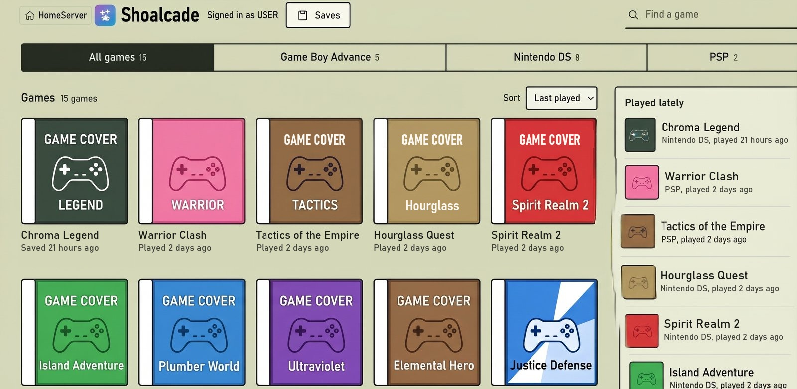
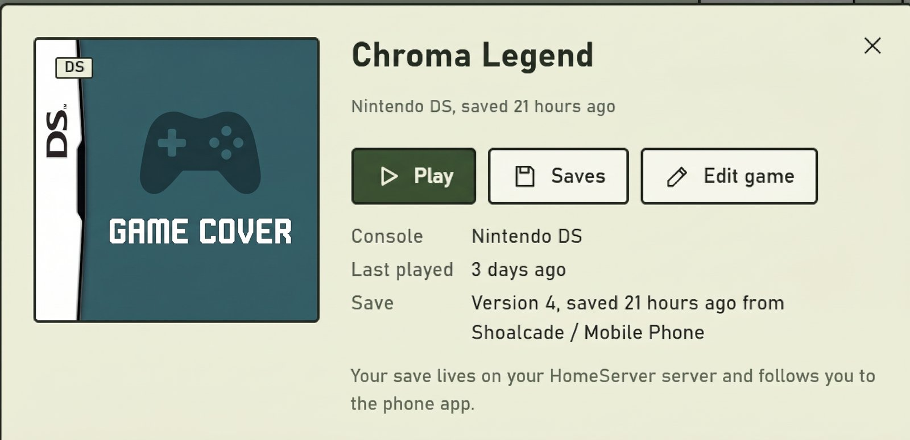
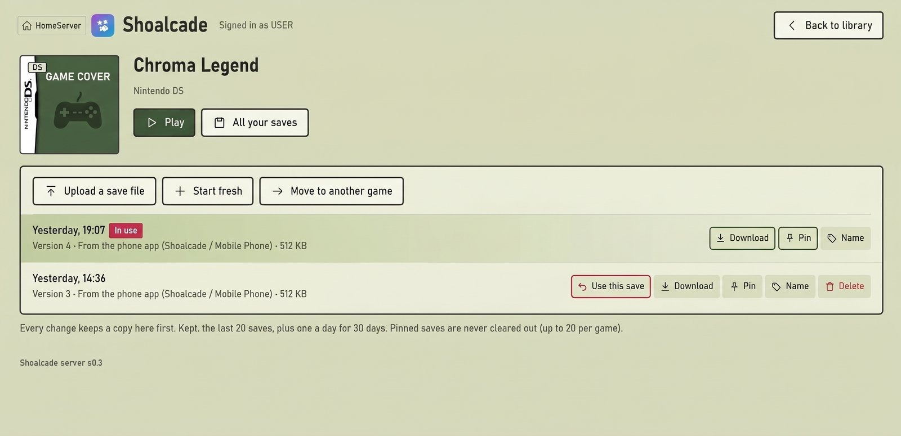

<p align="center">
  
</p>

<p align="center"><strong>Play the games you own from your own Jellyfin server: on your Android phone (offline) or in the browser, with safe saves.</strong></p>

<div align="center">

[](LICENSE)


[][discord]

</div>

> **Not an official Jellyfin project.** Shoalcade is an independent hobby project. It is **not made, endorsed or supported by the Jellyfin team** — please don't ask them for help with it.
>
> **Jellyfin** is a trademark of Jellyfin, Inc. Shoalcade uses the Jellyfin colour gradient only, as Jellyfin's brand guidelines allow.

---

## Contents

- [What it is](#what-it-is)
- [Your own games only](#your-own-games-only)
- [Supported consoles](#supported-consoles)
- [Screenshots](#screenshots)
- [Features](#features)
- [Requirements](#requirements)
- [Install](#install)
- [FAQ](#faq)
- [Troubleshooting](#troubleshooting)
- [Building from source](#building-from-source)
- [Community](#community)
- [Contributing, security and privacy](#contributing-security-and-privacy)
- [Licence and credits](#licence-and-credits)
- [Disclaimer](#disclaimer)

---

## What it is

**Two parts that work together:**

| Part | What it does |
|---|---|
| **Shoalcade plugin** (on your Jellyfin server) | Finds the games in your library, adds names and box art, keeps everyone's saves safe with full history, and adds a **browser player** |
| **Shoalcade app** (Android) | Downloads games to your phone and plays them **natively and offline**. Saves sync back to Jellyfin |

- **Jellyfin stays in charge:** your logins, your users, your library.
- **Shared saves:** the phone and the browser use the same saves, with older versions kept and **pinned** ones never cleared out.
- **Saves are never lost:** older versions are kept, and nothing is replaced without a copy.

---

## Your own games only

- Shoalcade provides **no games, ROMs, BIOS, firmware or keys**.
- It has **no piracy features**: no ROM sites, no downloads from the internet, no help finding games.
- Use only games **you own**, on **your own** server.
- **Issues, pull requests or chat that ask for or link to ROMs will be closed.**

---

## Supported consoles

| Console | Phone app | Browser player | Link play (phone) |
|---|---|---|---|
| **Game Boy / Game Boy Color** | ✅ mGBA | ✅ mGBA | ❌ |
| **Game Boy Advance** | ✅ mGBA | ✅ mGBA | ✅ gpSP (e.g. Pokémon trades and battles) |
| **Nintendo DS** | ✅ melonDS DS | ✅ melonDS | ✅ local wireless |
| **PlayStation (PS1)** | ✅ PCSX ReARMed | ✅ PCSX ReARMed | ❌ |
| **PSP** | ✅ PPSSPP (landscape) | ❌ not yet | ❌ |
| **Nintendo 3DS** | 🗓️ Listed as **"3DS support coming later"** — not downloadable or playable yet | ❌ | ❌ |

- **PS1:** one `.chd` or `.pbp` file per game. **No BIOS needed** (a built-in stand-in is used; some games may need a real BIOS, not supported yet). Save = one **memory card**, shared by the phone and the browser.
- **Other consoles are not shown.** Their files stay on your server, untouched.

---

## Screenshots

**Browser library** — covers, console tabs, search and a **Played lately** row



**A game's page** — **Play**, **Saves** and (for admins) **Edit game**



**Saves** — every version, with **Use this save**, **Pin**, **Name** and **Download**



**Jellyfin menu** — a **Shoalcade** link next to your other libraries


*Cover pictures in these screenshots are stand-ins.*

---

## Features

### 📱 Phone app

**Getting in**
- **Log in with Quick Connect** (approve a code from any signed-in Jellyfin device), or **Use username and password instead**
- **HTTPS only**; your login token is kept encrypted with the **Android Keystore**
- Warns clearly if the server plugin is **missing or too old**

**Your games list**
- **Box art** cached on the phone, so it shows offline
- **Sort** by **Name**, **Year**, **Platform** or **Last played** — remembered; **Last played** is the default and counts browser play too
- Console filter chips
- **Background downloads** with a progress notification and **Cancel**
- **Remove from phone (keeps save)**

**Playing**
- **Offline play** — once downloaded, a game needs no network at all
- **Portrait or landscape** — turn the phone and the game turns with it, **without restarting**; touch buttons move to either side of the game. Or fix a console to **Portrait** or **Landscape**
- **Side menu** — swipe in from the left edge, tap **☰ Menu**, press **Back** or the controller's **Home** button. The game **pauses** while it's open, and it works fully with a controller
- **On-screen touch buttons** (multi-touch) and **Bluetooth controllers**
- **Touch buttons hide by themselves** when you use a controller; tap the screen to bring them back (**Touch buttons**: **Auto** / **Always show** / **Always hide**, set per console)
- **Controls:** change which controller button does what, **per console and per controller**, kept on the phone
- **D-pad works like a joystick too:** tap an arm, or press and slide your thumb
- **DS:** screens **stacked**, **side by side** or **one big, one small**, with **swap** — chosen separately for upright and sideways. **Touch on the bottom screen**, even while holding a button
- **PSP:** landscape, see-through controls with an **analogue stick**; each game gets its own memory stick
- **PS1:** △ ○ ✕ □ with **L1 L2 R1 R2**; controller triggers work as L2/R2. Buttons match **by position**, so a controller's **A** (bottom on Xbox pads) is **○** — swap it in **Controls** if you prefer ✕
- **Game Boy cartridge clock** kept with the save and backed up (e.g. Pokémon Gold, Silver, Crystal)
- **Snapshots** — **Save snapshot** / **Load snapshot**, one per game with a picture, kept on the phone
- **Launch choice:** games with a snapshot ask **Continue from save** or **Or load a snapshot**
- Side menu: **Close Game** or **Close Game (and Upload)**
- Warns (**Keep playing** / **Close anyway**) if your latest save couldn't be kept

**Link play (same Wi-Fi)**
- Two phones on the **same Wi-Fi or a phone hotspot** link directly — **no server needed**
- **GBA** and **DS**, e.g. Pokémon trades and battles. One phone taps **Host**, the other **Join**
- The host shows a **4-digit PIN**; the joining phone types it, so no one else on the Wi-Fi can join
- Optional per-phone **DS wireless ID** switch
- Snapshots are off during link play

**Settings** (⚙ on the games list)
- Set **each console** without starting a game: **Screen**, **DS screens**, **Touch buttons** and **Controls**
- The side menu changes the **same settings** while you play, so the two always agree
- **Push all** / **Pull all**, your server and account, **Log out** (also ends the app's sign-in on Jellyfin; phone saves stay), storage used, and **About**
- **Saves → Not in your library:** phone saves for games that left your library — **Save a copy to a file…** or **Upload to another game…** (nothing is deleted)

**Save sync** (safety rules under [Saves](#-saves))
- **Upload save to Jellyfin** and **Get save from Jellyfin** per game
- **Push all** / **Pull all** (in **Settings**) — every downloaded game brought up to date in one go; any game needing a decision is listed at the end. A running one shows on the games list with **Stop**
- **Saves on Jellyfin…** panel: version list, **Use this save**, **Pin**, **Name**, **Replace with a file…**, **Save a copy to a file…**
- Tells you **once** if a phone save belongs to a game that's **no longer in your library**
- Moves old phone saves across from JellyEMU safely (asks if they differ)
- **About and licences** screen listing every included part and its source

### 💾 Saves

- **One save list per game, per person** — shared by the phone and the browser (DS included)
- **Version history:** the last **20**, plus **one a day for 30 days** (admins can change both)
- **Pin** a version (never cleared out), **Name** it, and see the **In use** badge
- **Use this save** — makes an older version current. **The save you were using stays in the list**
- Each version shows **where it came from**: the browser player, the phone app, an uploaded file, JellyEMU (imported) and more
- **Conflicts always ask, never pick silently.** If the phone and Jellyfin both changed: **Keep the phone's**, **Keep Jellyfin's** or **Decide later**. Both are kept either way
- **Newer-save check:** before a save would replace a newer one, you're asked, with both dates shown
- **Backups before every overwrite:** the replaced save goes to Jellyfin's history and the phone's backups first. If that fails, nothing is replaced
- **Snapshots are kept separate:** loading a snapshot **never changes your save** — only saving in the game does. A save made after loading one is marked **Saved after loading a snapshot**
- **DS and PS1 save sizes checked** — wrong-sized files are refused, so a save can't be quietly damaged
- **Empty PS1 memory cards** are never saved over a real save (unless you say so)
- **Damaged files are moved aside, never deleted**
- **Storage limits** per person: saves **2 GB** and snapshots **4 GB** by default, admin-adjustable

### 🌐 Browser player

**Library**
- Open it from the **Shoalcade** link in Jellyfin's menu, or at **`/shoalcade/`** on your server
- Uses your **Jellyfin web login** — no extra sign-in
- **Game covers**, **console tabs**, **search** and a **Played lately** row; works on phones too
- **Sort** by **Name**, **Year**, **Platform** or **Last played** — remembered per person, on any browser
- **Play** and **Saves** buttons on each game's own Jellyfin page
- **⚙ Settings:** **Manage saves**, **Phone app** (QR code or download link for the app) and per-console **Browser player** settings with **Reset to defaults**

**Playing** (powered by **EmulatorJS**)
- **Keyboard, gamepad and touch** controls
- Change your own controls **per console and per controller**, stored on the server
- Toolbar that hides itself: **pause**, **restart**, **fast-forward**, **volume**, **full screen**, **screenshot**
- **Quick snapshot** (F2) and **Load snapshot** (F4); snapshot slots kept on the server; **Snapshots** switch in settings
- **DS:** three **screen layouts** (plus swap), changeable while playing; **touch screen works with mouse and finger**
- **Sideways phone:** touch buttons sit in columns **beside the game**, not over it
- **PS1:** keyboard **E / R** or pad **LT / RT** for L2 / R2; very big discs show a note that they need a lot of memory
- **Saves upload by themselves** a few seconds after the game saves
- **Leaving too soon?** It asks: **Your save hasn't reached the server yet** → **Stay** or **Leave anyway**
- If another device changed the save: **Keep this browser's save** or **Keep Jellyfin's save (restarts the game)**

**Saves manager**
- Every version of a game's save: **Use this save**, **Pin**, **Name**, **Download**, **Upload a save file**, **Delete**, **Start fresh**
- **Move to another game** — e.g. after a ROM was renamed (Game Boy ↔ Game Boy Color allowed; otherwise same console only)
- Saves for games **Not in your library** stay reachable and movable
- Asks first before anything that could lose data

### 🗂️ Server and library

- **Own game scanner** — finds GB, GBC, GBA, DS, PS1, PSP and 3DS games, including zipped games and multi-disc sets (not PS1)
- A file is only listed if its type fits its folder's console (e.g. a `.gba` in a `PSP` folder is skipped)
- **Official names, year, developer, publisher and genre** from **libretro-database** (downloaded by your server, checked weekly, works from its own copy)
- **Box art** from libretro — your own pictures next to the ROMs and `.nfo` files still come first
- Box art switches itself on for games libraries (**Shoalcade box art (libretro)**; untick it any time)
- **Games library set-up in one click** from the settings page — never writes into your ROM folder
- **Games kept off Jellyfin's home page** and library menu by default. Search still finds them, and each person can put them back
- **Install from Jellyfin's own Catalogue** (plugin repository) or by hand
- Version shown on the settings page, browser pages and the app's About screen

### 🛠️ Admin tools

- **Admin game editor** (Jellyfin admins only, in the browser library): **Edit game** → **Save name**, **Upload a picture**, **Find a cover**, **Reset to automatic**
- **Locked edits:** your names and covers **survive library scans and "Replace all metadata"**
- **Find a cover** searches libretro's list for that console and shows a preview before you pick
- **Storage view:** each person's saves, snapshots and settings against their limits, server totals and a per-game breakdown — **sizes only, never anyone's save contents**
- **Settings:** browser player on/off, menu link and Play/Saves buttons on/off, keep games off the home page, versions and days kept, storage limits
- **Import JellyEMU saves** scheduled task — copies saves **read-only**; JellyEMU's files are never changed
- Shoalcade's scanner **stays off while JellyEMU is installed**, so the two never fight. Guide: [Moving from JellyEMU](guides/moving-from-jellyemu.md)

### 🔒 Security

- **Every endpoint needs a Jellyfin login**; admin features need a Jellyfin admin
- **Only ROM items are ever served** — your films and other media are never exposed. The one extra file is the phone app built into the plugin
- **Phone app download links** for QR codes last **10 minutes** and hold no login
- People see **only their own saves and settings**
- Game downloads use **Jellyfin's own download route** (login, library access and download permission all checked)
- **ROM file guard:** a disc list can't point outside its games folder
- **Upload limits:** a few at once per person, size caps, snapshots streamed to disk
- **Picture uploads** checked by their actual bytes and size
- Browser pages: strict security policy (they can only talk to your server), no HTML built from game names
- **App:** HTTPS only, token encrypted with the **Android Keystore**, never logged, never in a web address

### 🕶️ Privacy

- **No analytics, no tracking, no ads, no accounts with us**
- The only outside contact is **your server → libretro**, for game names and box art. No ROMs, hashes, saves or user names are sent
- The app talks **only to your Jellyfin server** (and to the other phone during link play)
- Full detail: [Privacy](guides/privacy.md)

---

## Requirements

| For | You need |
|---|---|
| **Server** | **Jellyfin 12.3**, an admin account, and an **HTTPS** address (the app won't use plain HTTP) |
| **Phone app** | **Android 11+** on a **64-bit ARM** phone (almost every phone from the last few years) |
| **Browser player** | A modern browser (Chrome, Edge, Firefox, Safari) on a computer, tablet or phone |
| **Games** | Your own games, in a folder Jellyfin can read |

---

## Install

**Four steps:** install the plugin on Jellyfin → make a games library → install the app → log in.
**Moving from JellyEMU?** Read [Moving from JellyEMU](guides/moving-from-jellyemu.md) **first**. Full detail and pictures: [Install guide](guides/install.md).

### 1. Install the plugin on your Jellyfin server

<details open>
<summary><strong>Option A — From Jellyfin's Catalogue (easiest; updates show up in Jellyfin)</strong></summary>

1. In Jellyfin: **Dashboard → Plugins → Repositories → +**
2. Name: **Shoalcade**. URL: **`https://raw.githubusercontent.com/BBBannon/Shoalcade/main/manifest.json`**
3. **Dashboard → Plugins → Catalogue → Shoalcade → Install**
4. **Restart Jellyfin**, then refresh the browser (**Ctrl+F5**)

</details>

<details>
<summary><strong>Option B — Manual install (zip file)</strong></summary>

1. Download **`Shoalcade_s<version>.zip`** from [Releases](https://github.com/BBBannon/Shoalcade/releases)
2. Unzip it into Jellyfin's **`plugins/Shoalcade_<version>/`** folder:
   - **Linux (usual):** `/var/lib/jellyfin/plugins/`
   - **Docker:** the `plugins` folder inside your `/config` volume
   - **Windows:** `C:\ProgramData\Jellyfin\Server\plugins\`
3. Linux only: make sure Jellyfin can read it — `chown -R jellyfin:jellyfin <folder>`
4. **Restart Jellyfin**

</details>

**Check:** **Dashboard → Plugins** shows **Shoalcade** as **Active**.

### 2. Make a games library

1. Put your games in **one folder per console** (short names work too: `gb`, `gbc`, `gba`, `nds`, `ps1`, `psx`, `psp`, `3ds`):

```
/media/games/
├── Game Boy/            .gb
├── Game Boy Color/      .gbc
├── Game Boy Advance/    .gba
├── Nintendo DS/         .nds
├── PS1/                 .chd .pbp   (one file per game)
└── PSP/                 .iso .cso .pbp .chd
```

2. **Dashboard → Plugins → Shoalcade → Add a games library**
3. Give it a **Name** and the **ROM folder on the server** → **Create games library**
4. Press **Scan for new games** and wait for it to finish

- A `.zip` or `.7z` holding one game is fine (not PS1). **Nothing is ever written into your ROM folder.**
- **PS1:** not yet `.bin/.cue`, `.iso`, archives or multi-disc games — see the [Install guide](guides/install.md).

### 3. Install the app on your Android phone

1. Get the app, either way:
   - **From your Jellyfin:** open Shoalcade in a browser, then **Settings → Phone app**. Scan the QR code with the phone, or tap **Download the phone app**. The app comes inside the plugin, so its version always matches.
   - **From GitHub:** [`Shoalcade.apk`](https://github.com/BBBannon/Shoalcade/releases/latest/download/Shoalcade.apk) (always the newest). Each [release](https://github.com/BBBannon/Shoalcade/releases) has `Shoalcade.apk` and `Shoalcade-<version>.apk`.
2. Open it. When asked, allow **Install unknown apps** for your browser or file manager
3. Tap **Install**

- **Updating:** install the new APK over the old one. Your login, games and saves stay.
- **Don't uninstall first** — that deletes the phone's saves. **Push all** before any uninstall.

### 4. Log in

1. Open **Shoalcade** and type your server's **HTTPS** address
2. **Log in with Quick Connect** (approve the code on any signed-in Jellyfin device — an admin turns Quick Connect on in **Dashboard → General**), or **Use username and password instead**
3. Tap a game → **Download** → **Play**

**Browser player:** open the **Shoalcade** link in Jellyfin's menu, or go to `https://<your-server>/shoalcade/`.

---

## FAQ

**Is this legal? Where do I get games?**
Shoalcade is an emulator front-end with **no games inside** and **no help finding them**. Use only games you own — the law on making your own copies differs by country, so check yours.

**Why isn't it on Google Play?**
It's a hobby project that plays your own files from your own server. You install the APK from [GitHub Releases](https://github.com/BBBannon/Shoalcade/releases). Updates install over the top and keep your games and saves.

**Does it work offline?**
**Yes.** Once a game is on your phone, it plays with no network at all. Upload your save when you're back online. The browser player needs your server.

**Where are my saves, and are they safe?**
On your Jellyfin server, one list per game per person, with **version history** (last 20, plus one a day for 30 days). Nothing is replaced without a copy first. Back up Jellyfin's data folder (`shoalcade/` inside it) like the rest of Jellyfin.

**What if the phone and the server saves are different?**
The app **asks**: **Keep the phone's**, **Keep Jellyfin's** or **Decide later**. It never picks silently, and both copies are kept either way.

**Do snapshots sync?**
No. Only **in-game saves** sync. Snapshots stay where you made them (phone or browser), and loading one never changes your save.

**Can my kids or other people use it? Can I stop downloads?**
Yes — it uses **Jellyfin's own users**. Each person has their own saves. Jellyfin's **library access** decides who sees the games library, and Jellyfin's **Allow media downloading** permission is needed to play (on the phone and in the browser). There's no separate kids mode.

**Which consoles? Why not SNES or N64?**
**GB, GBC, GBA, DS, PS1 and PSP.** Each console is a lot of work to make safe for saves, so the list is small for now. Other consoles may come later; their files stay on your server untouched.

**Will 3DS work?**
**Not yet.** 3DS games appear in the app as **"3DS support coming later"**. 3DS is too heavy for the built-in emulators, so it's planned for later with no date.

**Is there an iPhone version?**
No. The app is **Android only**. The browser player runs in a modern browser, but iPhone and iPad aren't tested.

**Do I need JellyEMU? I already use it.**
**No.** Shoalcade replaces JellyEMU. It can import your JellyEMU saves (read-only) and stays out of the way while JellyEMU is installed. Follow [Moving from JellyEMU](guides/moving-from-jellyemu.md).

**What leaves my server?**
Only requests from **your server to libretro**, for game names and box art. No ROMs, hashes, saves or user names. You can turn box art off, or use your own mirror. See [Privacy](guides/privacy.md).

**What happens if I uninstall the app?**
Everything on the phone goes: games, **phone saves** and snapshots. Saves you uploaded stay on Jellyfin. **Use Push all first** (**Settings → Push all**).

**I'm getting a new phone. How do I move over?**
On the old phone: **Settings → Push all**. On the new phone: install the app, log in, download your games. Your saves come from Jellyfin. (The app isn't included in Android's cloud backup or phone-to-phone copy, because your login only works on the phone that made it.)

**What happens if I uninstall the plugin?**
Your ROMs and everyone's saves stay on the server, so a reinstall picks up where you left off. See [Privacy](guides/privacy.md) for how to remove everything.

**A game has the wrong name or no cover. Can I fix it?**
Yes, if you're a Jellyfin admin: browser library → game → **Edit game**. Use **Save name**, **Upload a picture** or **Find a cover**. Your changes survive rescans.

**Does it work with controllers or Android TV?**
**Bluetooth controllers:** yes, in the app and the browser. The app **hides the touch buttons by itself** while you use a controller, and **Settings → Controls** (or the side menu while playing) lets you **change the buttons per console and per controller**. The side menu works fully with a controller. **Android TV:** no — the app is built for phones.

**Is it affiliated with Jellyfin?**
**No.** It's an independent project that uses Jellyfin as its server. Please don't ask the Jellyfin team for help with it.

**How do I get help, report a bug or a security problem?**
- **Chat and help:** [Discord][discord]
- **Bugs and ideas:** [Discord][discord]
- **Security problems:** privately, as in [SECURITY.md](SECURITY.md) — never in public

---

## Troubleshooting

| Problem | Try |
|---|---|
| **No games after a scan** | Check the library was made with **Create games library** (Shoalcade's settings page). Put games in console folders (`gba`, `nds`, `ps1`, `psp`…) — a file whose type doesn't fit its folder's console is skipped. Run **Scan for new games** again. Check **Dashboard → Logs** for Shoalcade lines |
| **Games missing after removing JellyEMU, or the plugin not showing after an update** | Do a **full restart** — stop and start the Jellyfin service or container, not just the dashboard button. Then scan |
| **App shows a red banner** | The plugin is missing or too old for the app. Update the plugin |
| **Can't log in** | Use the **HTTPS** address. Type the username exactly. Try **Log in with Quick Connect** (an admin turns it on in **Dashboard → General**) |
| **Download button greyed out** | You're offline, the game is 3DS, or your Jellyfin user isn't allowed to download — ask your admin |
| **No box art** | Wait for the next scan. Some games have no libretro art — an admin can use **Find a cover** or **Upload a picture** |
| **Browser player won't load** | Refresh with **Ctrl+F5**. Check an admin hasn't turned the browser player off |

---

## Building from source

### Android app

- **Needs:** **JDK 17**, the **Android SDK**, **NDK 27.2** and **CMake 3.22** (Android Studio's SDK Manager installs them).
- **One file isn't in git:** `android/app/src/main/assets/PPSSPP.zip` (PPSSPP's support files: free replacement fonts, compatibility list; **no Sony BIOS**).
  - Download it from the libretro buildbot: `https://buildbot.libretro.com/assets/system/PPSSPP.zip`
  - Save it as `android/app/src/main/assets/PPSSPP.zip`
  - Without it the app builds, but **PSP games won't start**.
- The emulator cores are already in the repo (`android/app/src/main/jniLibs/`), from the libretro buildbot. Versions and sources: [docs/licences.md](docs/licences.md).

```bash
cd android
./gradlew assembleDebug            # APK → android/app/build/outputs/apk/debug/
```

- Or run `./build.sh` from the repo root: it builds the debug APK and copies it to `dist/`.
- `./build.sh release` builds a **signed, shrunk release APK** into `dist/`. It needs **your own signing key** (a properties file named by `SHOALCADE_SIGNING_PROPERTIES`); without one it stops rather than build an unsigned APK.

### Jellyfin plugin

- **Needs:** **.NET 10 SDK**, `curl`, `sha256sum`, `tar` and `zip` (or Python).
- `server/build.sh` downloads **EmulatorJS** from npm, **checks every file against `server/emulatorjs.lock`** (SHA-256), builds the plugin and makes the install zip.

```bash
server/build.sh                    # → dist/server/Shoalcade_s<version>.zip
```

- Install the zip by hand: unzip into Jellyfin's `plugins/Shoalcade_<version>/` folder, then restart Jellyfin.

---

## Community

- 💬 **Chat and help:** [Join us on Discord][discord]
- 🐞 **Bugs and ideas:** [Discord][discord] — the quickest way to get them looked at
- 🔒 **Security problems:** privately, as in [SECURITY.md](SECURITY.md)

⚠️ **Never post** server addresses, Jellyfin tokens, passwords, ROMs or saves — on Discord, GitHub or anywhere else.

---

## Contributing, security and privacy

| Topic | Read |
|---|---|
| **Contributing** | [CONTRIBUTING.md](CONTRIBUTING.md) |
| **Security** | [SECURITY.md](SECURITY.md) |
| **Privacy** | [guides/privacy.md](guides/privacy.md) |

---

## Licence and credits

- Shoalcade is **GPL-3.0** — see [LICENSE](LICENSE).
- Built on the work of others — **thank you**:

| Part | Used for | Licence |
|---|---|---|
| **LibretroDroid** | App emulator front-end | GPL-3.0 |
| **mGBA** | GB, GBC, GBA (app and browser) | MPL-2.0 |
| **melonDS DS** / **melonDS** | DS (app / browser) | GPL-3.0 |
| **gpSP** | GBA link play (app) | GPL-2.0-or-later |
| **PPSSPP** | PSP (app) | GPL-2.0-or-later |
| **PCSX ReARMed** | PS1 (app and browser) | GPL-2.0-or-later |
| **EmulatorJS** | Browser player | GPL-3.0 |
| **JellyEMU** | Code ported into our scanner | MIT |
| **libretro-database** | Game names (downloaded by your server, not shipped) | CC-BY-SA-4.0 |
| **libretro-thumbnails** | Box art (downloaded by your server, not shipped) | Art belongs to the games' publishers |

- Every part, version and source: [THIRD_PARTY_NOTICES.md](THIRD_PARTY_NOTICES.md)
- Full licence detail: [docs/licences.md](docs/licences.md)
- Built with help from [Claude Code](https://claude.com/claude-code).

---

## Disclaimer

- Shoalcade is **not affiliated with or endorsed by** Jellyfin, Nintendo or Sony.
- Jellyfin is a trademark of Jellyfin, Inc. Nintendo, Game Boy, Nintendo DS, Nintendo 3DS, Sony, PlayStation and PSP are trademarks of their owners.
- Shoalcade is provided **as is, with no warranty** (see [LICENSE](LICENSE)). **Back up your saves.**

<!-- Discord invite: change it here only. -->
[discord]: https://discord.gg/SRDBXwhre
